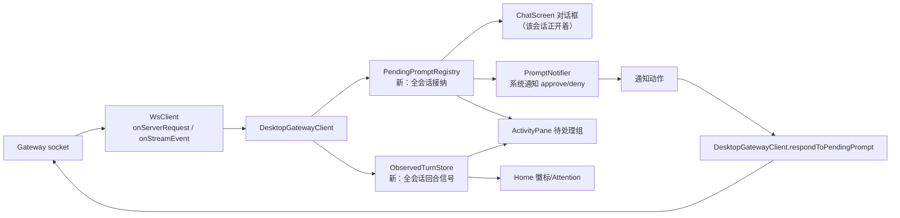
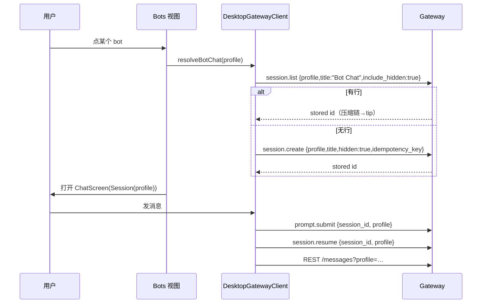
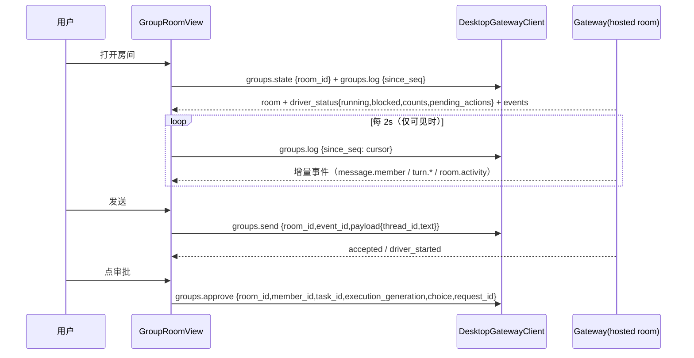

# Bot Mode P1 + 审批通知 + Activity 利用 + APK 安装后自删 — 实施计划

> **For Hermes:** 逐任务执行（TDD），每个工作包过门禁后提交；验收基线从 **1404** 起算。
> 这是计划文档，不执行任何代码改动。

**Goal:** 让手机端具备桌面 Bot Mode 的核心体验（bot 名册 + 单聊 + **服务端托管的群组房间**），并把「其他会话的审批/提问」从**被客户端拒绝**改成**可通知、可在 App 内外应答**；顺带把闲置的「活动」页做成真实的操作时间线，以及 APK 安装后自动清理安装包。

**Architecture:** 三条主线共用一个新的「中央事件层」：`DesktopGatewayClient` 从"只服务当前打开的会话"升级为"接纳所有会话的阻塞提示与回合信号"→ 分发到（a）聊天页对话框（b）系统通知（c）Activity 收件箱。Bot 模式走**服务端既有 profile 路由**（一个 socket + params.profile），不引入多 socket。APK 清理用"下次启动对账"（自覆盖安装必然杀进程，没有同步回调）。

**Tech Stack:** Flutter/Dart（gen-l10n、flutter_local_notifications），Kotlin（FGS、MediaStore、NotificationChannel），服务端 RPC（profiles/session/groups/bot_relay）。

---

## 1. 需求与可行性判定（结论先行）

| 需求 | 判定 | 关键依据 |
|---|---|---|
| Bot Mode：名册 + 单聊 | ✅ 可做（P1） | `profiles.list` 直接给 `canonical_session`；所有会话级 RPC 契约带 `profile`（`ProfileParams`/`SessionParams`）；`session.create` 支持 `title`/`hidden`/`idempotency_key` |
| Bot Mode：群组房间 | ✅ **本次一并纳入（P1B）**，服务端全托管 | `groups.*` 共 18 方法；发送 `groups.send{thread_id,text}`，渲染靠 `groups.state` + `groups.log{since_seq}`（桌面 2s 轮询）；审批/重试/停止走 `driver_status.pending_actions` |
| 其他会话审批 → 通知（而不是拒绝） | ✅ 可做，**根因已定位** | 无聊天页监听时 `_handleServerRequest` 返回 false → ws 回 `-32601` → 服务端 `_emit_approval_request` **withdraw**（"attached client cannot answer"），用户什么都看不到 |
| APK 安装后删安装包 | ✅ 可做（下次启动对账） | 自覆盖安装会杀本进程，安装完成无同步回调；缓存副本 + MediaStore 行可在下次启动删除 |
| 会话完成通知（**不打开会话也能收**） | ✅ 可做，桌面同款机制 | 事件按**会话 transport** 投递（`server.py:697`）——桌面"开着就能收"也是因为它挂上了会话；手机可用 `session.active_list` + `session.activate{omit_messages:true}` 挂上所有运行中会话（详见 §2.5） |
| 底部通知卡堆积（"已更新技能"刷屏） | ✅ 可修，**纯 App 侧** | `review.summary` 被 append 进时间线末尾；卡片无关闭、无 TTL；`_gatewayNotices` 还有进程级 `static` 缓存（每会话列表上限 20，static map 按会话**无限驻留**）→ 只能杀进程清 |
| 「活动」页利用 | ✅ 可做，**当前数据源是空转的** | Activity/Home 信号只读「客户端回合日记账」（仅 turn_recovery 路径写入）→ stock 网关下永远空 |

**非目标（本次不做）**：跨网关 bot 中继（`bot_relay.*`，桌面多 socket 专属）；桌面插件运行时；完整 slash 层；群组**跨安装复制**（`groups.peer.invite/replicate/promote`，同一网关内房间即可）；群消息附件（只发文本，`attachments` 字段保留后续）。

---

## 2. 现状证据（为什么现在这样）

### 2.1 审批为什么"被拒绝"
| 步骤 | 代码 | 行为 |
|---|---|---|
| 1 | `ws_client.dart:709` `_deliverServerRequest` | 回调返回 false → 立即回 `{"error":{"code":-32601,"message":"no handler for server request: approval"}}` |
| 2 | `desktop_gateway_client.dart:1276` `_handleServerRequest` | 会话未映射或 `!_acceptsAnyAsyncEvent(mobileSessionId)` → **return false** |
| 3 | 服务端 `server.py:835` `_emit_approval_request` | `-32601` 或无人能答 → `withdraw_gateway_approval(...)`（不是 deny，但**提示彻底消失**） |
| 4 | 现有通知 | 只由**已挂载的 ChatScreen**在 `_appInBackground` 时镜像自己的会话（`chat_screen.dart:1769`）——其他会话无入口 |

> 注意：服务端的 `approvals.timeout`（本机配置 60s）只在"无人应答"时触发；一旦客户端回 `-32601`，等待**立即结束**，连超时撤卡都来不及广播。

### 2.2 活动页为什么空
- `workspace_screen.dart:806` → `ActivityPane(loadFeed: _loadActivity)`；`_loadActivityFeedFromJournal`（487）与 `_loadTurnSignalsFromJournal`（372）都只读 `GatewayTurnJournal`。
- 日记账由 `gateway_turn_coordinator.dart` 写入 = **turn_recovery 能力专用路径**；stock 网关走 legacy 提交，不写账 → 时间线恒空、Home 徽标恒 0。

### 2.3 Bot 模式的既有门（服务端）
| 能力 | 契约 | 备注 |
|---|---|---|
| 名册 | `profiles.list {include_sessions:true}`（`methods_profiles.py:282`） | 行内 `canonical_session` 由服务端按标题解析 |
| 标题即身份 | `session.list {profile,title:"Bot Chat",include_hidden:true}`（`contracts/sessions.py:221`） | windowless；压缩链解析到 tip |
| 建 canonical 聊天 | `session.create {profile,title:"Bot Chat",hidden:true,idempotency_key}`（`:118`） | `UNIQUE(title)` 保证一对一；冲突必须先查后建 |
| 发消息/续接 | `prompt.submit`/`session.resume` 均继承带 `profile` 的基类 | `ws_client.withProfile` 已支持 params 内覆盖 |
| 历史 | `GET /api/sessions/{id}/messages?profile=` | `connection_manager.dart:785` 需加参数 |

### 2.4 审批"不可用"的责任链（用户问题：服务端判的还是 App 回的？）

**结论：App 先回"不可用"，服务端据此撤回；而且我们回错了错误码。**

| 步骤 | 代码 | 事实 |
|---|---|---|
| 1 | `desktop_gateway_client.dart:1276` `_handleServerRequest` | 会话未映射或 `!_acceptsAnyAsyncEvent` → **return false** |
| 2 | `ws_client.dart:709` `_deliverServerRequest` | false → 发 `{"error":{"code":-32601,"message":"no handler for server request: approval"}}` |
| 3 | 服务端 `server_requests.py:281` `resolve_response` | **除 4404 外的任何 error** → `req.result=None, answered=False` → `on_result(None)` |
| 4 | 服务端 `server.py:835` `_emit_approval_request` | `on_result(None)` → `withdraw_gateway_approval(..., "the attached client cannot answer approval requests (update the Hermes app)")` → **审批从队列消失**（不是 deny，但也永远答不上） |

**协议其实有正确的"我不显示"语义**：`NOT_SHOWN_CODE = 4404`（`server_requests.py:119`）。
- `resolve_response` 见 4404 → `_decline(rid, transport)`：按**连接**记录 decline，**只有该会话所有在线客户端都 decline** 才结算（"a bystander window must not beat the owner"）；
- 于是：手机没开该会话 → 回 4404 → **桌面端仍可正常应答**；手机是唯一客户端时才由服务端结束等待（agent 立即得到"没人看"的结果，而不是傻等）。
- 我们现在回 `-32601`：多端场景下**手机会把桌面的审批一起撤掉**——这是必须修的跨端缺陷。

**改法（P2 核心）**：
1. 能显示但不在前台/不在当前会话 → **接纳并登记**（return true），发通知，用户在窗口内可答；
2. 明确不显示（通知未开、vault/桌面桥方法、或用户关闭了审批通知）→ 回 **4404**，让桌面 owner 赢；
3. 永不再回 `-32601`（保留仅给真正无 handler 的方法，如未来新方法）。

### 2.5 完成通知为什么收不到（用户：会话完成能不能发个通知）

| 现状 | 代码 | 后果 |
|---|---|---|
| 完成/失败通知唯一入口 | `chat_screen.dart:1726` `_onTurnSettled` —— 订阅 **turn recovery 状态流** | 该流只存在于 turn_recovery 能力路径（客户端回合协调器）；**stock 网关永不触发** |
| 第二道门 | `if (!mounted || !_appInBackground) return;`（`:1727`） | 只有"该聊天页已挂载 + App 在后台"才发 |
| 其他会话 | 无任何监听 | 完全静默 |

**可用信号**（已在异步桥白名单）：`message.complete`（带 `rendered`/`text` 摘要）、`turn.end`、`turn.error`、`error`——它们是**全会话扇出**的，共享 `DesktopGatewayClient` 全都能收到。通知偏好也现成：`NotificationPrefs` 的 `turnDone`/`turnError` 两个开关（含总开关）。

### 2.5b 网关的投递模型（为什么"打开会话才行"）

| 事实 | 代码 | 含义 |
|---|---|---|
| 事件帧按 session 路由 | `server.py:697` `write_json`：`params.session_id` → 该会话的 `transport.write` | **只有该会话 transport 的附着者**能收到它的事件 |
| 多客户端 = FanoutTransport | `session_transports.py:92-120` | 同一会话可挂多个 peer（桌面 + 手机互不踢） |
| 附着方式 | `session.resume`（带历史）/ **`session.activate {omit_messages:true}`**（只挂，不读历史） | 不需要打开 UI 也能挂 |
| 运行中会话清单 | **`session.active_list`**（`contracts/sessions.py:267`）：id/title/status(`idle|starting|waiting|working|streaming|resuming`)/last_active/preview | 5s 轮询即可发现新开的回合 |
| 挂上即补发未决请求 | `_open_requests(sid)` 在 `session.resume`/`session.activate`/`session.events.since` 回包重投 | 审批在挂上之前发生也能收到 |

**结论**：桌面"只要开着就能收到"并不神秘——它把会话挂上了。手机做同款 = **LiveSessionWatcher**（P2-8）：每 5s 拉 `session.active_list`，对非 idle 且未附着的会话调 `session.activate{omit_messages:true}`；断线重连后重挂。挂上后终端帧（`message.complete`/`turn.end`）与审批请求都会到手机 → 完成通知与审批通知对**任意会话**生效，无需打开。

→ 于是完成通知只需把数据源从 turn_recovery 状态流改为"中央层消费终端帧"（P2-9），而"收得到"由 P2-8 保证。

### 2.6 底部通知卡为什么"粘住不放"

| 事实 | 代码 | 后果 |
|---|---|---|
| 后台复盘（技能/记忆沉淀）发 `review.summary` | `agent/background_review.py:1211` → 事件 `review.summary`（异步桥白名单内） | 每次沉淀产生一条 |
| 被当作时间线尾巴 | `chat_display_items.dart:106` `displayItems.addAll(notices)` | 永远贴在底部，跟消息流不混排 |
| 卡片无关闭/无过期 | `gateway_insight_card.dart:48` `GatewayNoticeCard` 无 ✕、无 TTL | 只能看它堆着 |
| 进程级驻留 | `chat_screen.dart:681` `static final Map<String, List<GatewayNotice>> _savedGatewayNotices`（每会话列表上限 20，map 按会话**无限驻留**） | 切走再回来还在；只有杀进程清空 |

**修复方向（桌面同款"刷走"语义）**：`review.summary` 合并成**一张**可关闭的复盘卡（"Hermes 复盘：N 条更新"，点开看明细），背景任务卡最多 2 张且可关；**去掉跨页面静态缓存**（瞬态信息，重进会话不复活）；不再为 review 发系统通知。

---

## 3. 总体架构

### 3.1 中央事件层（P2/P3 的地基）

### 3.2 审批生命周期（改后）

| 阶段 | 客户端行为 |
|---|---|
| 请求到达（任意会话） | 登记 → **return true**（绝不回 -32601） |
| 该会话在前台且聊天页可见 | 现有对话框（不变） |
| 其他会话 / App 在后台 | 高优通知（approval：允许/拒绝；clarify/sudo/secret：打开） |
| 用户点通知动作 | App 级直接应答（不依赖聊天页） |
| 用户点通知正文 | 深链到该会话（能映射时）否则 Activity 收件箱 |
| 服务端撤卡/超时 | `request.cancel` → 撤通知 + 清收件箱条目 |
| 应答成功 | 撤通知 + 清条目 + 会话内对话框关闭（现有语义） |

### 3.3 Bot 单聊数据流

### 3.3b 群组房间数据流（P1B）

| 事件 kind（服务端） | 手机渲染 |
|---|---|
| `message.user` | 用户气泡（payload.text / attachments） |
| `message.member` | bot 气泡（actor.handle/display_name + text；`discussion_event_id` 归属） |
| `turn.started/settled/failed/cancelled/deferred/reassigned` | 成员"思考中/完成/失败/取消/排队/改派"状态行 |
| `room.activity` | 讨论驱动状态（status=settled/bounded） |
| `member.unavailable` | 成员不可用横幅 |
| `room.created/renamed/members_changed/disbanded` | 系统行；disbanded 关闭输入框 |
| `authority.claimed/lost`、`room.stop_requested` | 调试级系统行（折叠） |

### 3.4 APK 安装后自删生命周期

| 时点 | 动作 |
|---|---|
| 保存并安装 | 记录 `{versionCodeAtSave, downloadsUri, cachePath}` 到 SharedPreferences |
| 系统安装器覆盖安装 | 本进程被杀（无同步回调） |
| 下次启动 | 若 `currentVersionCode > versionCodeAtSave` → 删除 **MediaStore 行** + 缓存 APK；否则只清 `cacheDir/install` 里 **≥7 天**的副本（**不动 Downloads 里用户保留的那份**） |

---

## 4. 工作包与任务（按序执行）

> 每个任务 = 一次 RED→GREEN→门禁→提交。测试命令统一带 `NO_PROXY=127.0.0.1,localhost`。

### P0 · profile 维度打通（Bot 的地基）

| # | 任务 | 文件 | 测试 |
|---|---|---|---|
| P0-1 | `Session.profile`（可空，null=连接默认）+ 构造/解析默认 null | `lib/core/models/session.dart` | `test/session_model_test.dart`（如无则新建：默认 null 不改既有行为） |
| P0-2 | `DesktopGatewayClient` 全链路接受 `profile`：`ensureSession(_, profile:)` → `_connect/_refreshSession/_resumeOrCreate` → `session.create/resume` 参数；**复合键 `profile::id` 只用于 `_gatewaySessionIds/_storedSessionIds` 内部映射——对外监听 API（`setAsyncEventListener`/`setTurnSettledListener`/`addLiveTurnListener`）仍以 `Session.id` 为键**，边界写进测试 | `lib/core/services/desktop_gateway_client.dart`（759/332/514 一带） | 新 `test/desktop_gateway_profile_routing_test.dart`：假网关断言 create/resume 帧带 profile；同 id 不同 profile 不串映射 |
| P0-3 | `ApiClient.getMessages(_, profile:)` → `?profile=` | `lib/core/services/connection_manager.dart:785` | 同测试文件：断言 URL query |
| P0-4 | ChatScreen 全调用点带 `widget.session.profile`：`ensureSession`(1340)、`_fetchMessages`(2008)、`slashExec`、`respondToApproval`、`interrupt`、跟随 resume | `lib/core/screens/chat_screen.dart` | 扩展 `test/chat_compress_test.dart`：bot 会话下 slash.exec 带 profile |

**验收**：普通会话（profile=null）全量测试零回归；造一个 `Session(profile:'research')` 的聊天页，所有 WS/REST 帧带 `profile:"research"`。

### P1 · Bots 名册 + 单聊

| # | 任务 | 文件 | 测试 |
|---|---|---|---|
| P1-1 | `listProfiles()` → `List<BotProfile>`（name/displayName/model/description/canonicalSession） | `desktop_gateway_client.dart` | 新 `test/bot_roster_test.dart`：帧形状、canonical 缺失容错 |
| P1-2 | `resolveBotChat(profile)`：先 `session.list{title:"Bot Chat",include_hidden:true}` → 有则返回；无则 `session.create{title,hidden:true,idempotency_key}` → **建后复查收养**（并发/已存在） | `desktop_gateway_client.dart` | 同文件：三态（存在/不存在/冲突收养），**断言从不存 session-id 指针** |
| P1-3 | Bots 视图：Chats 目的地顶部分段（会话 / Bots，不加第 6 个底栏）；行 = 头像占位 + 名称 + 最近消息；可见时 5s 轮询 | 新 `lib/core/widgets/bots_view.dart` + **`lib/core/screens/workspace_sessions_screen.dart`**（Chats pane 的真实渲染者，`workspace_screen.dart:760`）接入；`session_list_screen.dart` 是另一条路由，不要改它 | 新 `test/bots_view_test.dart`（注入 loader）：渲染、空态、点击回调 |
| P1-4 | 点 bot → `resolveBotChat` → 打开 ChatScreen（标题=bot displayName，带返回）；失败给诚实提示 | `bots_view.dart` → workspace 导航 | 同测试：点击后 Navigator push 的 Session.profile 正确 |
| P1-5 | l10n：`bots`、`bots_empty`、`bot_chat_open_failed`、`bot_profile_model`（en/zh/zh_Hans） | `lib/l10n/app_{en,zh,zh_Hans}.arb` | zh_smoke 自动覆盖 |

**验收**：真机（或 mock 网关）列出机器上全部 profile；点 bot 进入其 canonical 聊天；发消息、流式、压缩、历史全部落在该 profile（另一 profile 的会话列表不受影响）。

### P1B · 群组房间（Bot Mode 群聊，服务端托管）

> 房间由网关的 hosted-room driver 驱动：客户端只负责「列房间 / 建房间 / 拉日志 / 发消息 / 处理 pending_actions」。同一网关内即可用；跨安装复制不在本次范围。

| # | 任务 | 文件 | 测试 |
|---|---|---|---|
| P1B-1 | 群组 RPC 封装 + 模型：`groups.capabilities/list/create/state/log/send/stop/approve/retry/rename/disband`；`Room/RoomMember/RoomEvent/RoomDriverStatus` 解析（**OpenModel 容错**：legacy 行多字段不崩） | 新 `lib/core/services/group_rooms_client.dart`（借 `DesktopGatewayClient` 的 socket/profile 注入） | 新 `test/group_rooms_client_test.dart`：帧形状、`profile` 注入、`stale cursor` 容错、错误码映射 |
| P1B-2 | 房间列表 + 创建：Bots 分段加入「群组」第三段（会话 / Bots / 群组）；`groups.list`（含 disbanded 开关）；创建对话框：名称 + `capabilities.seatable_profiles` 多选（提交 `members:[{profile,handle,display_name}]`，`room_id`=uuid） | 新 `lib/core/widgets/group_rooms_view.dart` | 新 `test/group_rooms_view_test.dart`：列表/空态/创建参数 |
| P1B-3 | 房间视图：进入先 `groups.state`（取 `latest_seq` 作游标）→ `groups.log{since_seq}` 增量；**2s 轮询仅可见时**；事件渲染表见 §3.3b；自动贴底（复用 `ChatScrollCoordinator`）；断线重入从 cursor 续拉 | 新 `lib/core/screens/group_room_screen.dart` | 新 `test/group_room_screen_test.dart`：事件渲染、游标续拉、可见性暂停 |
| P1B-4 | 发送：`groups.send{room_id,event_id(uuid),payload:{thread_id,text}}` 单飞 + **幂等重试日志**（同 `event_id` 落盘重发，服务端幂等）；失败提示不丢草稿 | `group_room_screen.dart` + 新 `lib/core/services/group_send_journal.dart` | 同测试：重试复用同一 event_id、双击只发一次 |
| P1B-5 | 驱动控制：`driver_status.pending_actions` → 审批卡（`groups.approve{room_id,member_id,task_id,execution_generation,choice,request_id}`）/ 重试（`groups.retry{task_id}`）；`groups.stop`（红色确认）；菜单 `rename`/`disband` | `group_room_screen.dart` | 同测试：四个动作帧 + 确认门 |
| P1B-6 | 群组阻塞通知（**依赖 P2-4 的 PromptNotifier，排在 P2 落地后执行；P1B 验收不含此项**）：房间 `blocked=true` 或出现 approval 动作 → 复用 P2 通知通道（`kind=input`，标题「群里需要你 — 房间名」）| `prompt_notifier.dart` | `test/prompt_notifier_test.dart` 增用例 |
| P1B-7 | l10n：`groups`/`group_new`/`group_members`/`group_empty`/`group_send_failed`/`group_stopped`/`group_disbanded`/`group_approval_needed` | arb ×3 | zh_smoke |

**验收**：建一个含 2 个 bot 的房间 → 发一句 → 两个 bot 依 @提及/默认全员规则应答（服务端判定，不用客户端编排）；成员审批可在手机点；stop/rename/disband 全通；杀掉 App 重进，从游标续拉不重复不丢。

### P2 · 审批/输入请求中央化 + 通知（核心修复）

| # | 任务 | 文件 | 测试 |
|---|---|---|---|
| P2-0 | **拒绝码纠正**：明确"不显示"时回 `4404`（NOT_SHOWN）而非 `-32601`——`request.fail(4404, …)` **之后必须 `return true`**（`ws_client.dart:730-732`：回调返回 false 会紧接着再补一帧 `-32601`，把 4404 的语义抵消）；多端场景桌面仍可应答；仅所有客户端都 decline 时服务端结束等待 | `desktop_gateway_client.dart:1276`、`ws_client` 常量 | `test/ws_server_requests_test.dart`：手机回 4404 帧形状且**该请求只发出一个响应帧**；**回归：两个人同时在线时手机不撤桌面审批**（服务端语义以注释钉住） |
| P2-1 | `PendingPrompt` 模型 + `PendingPromptRegistry`（id/method/sessionId(可空)/gatewaySessionId/摘要/choices/时间） | 新 `lib/core/services/pending_prompts.dart` | 新 `test/pending_prompts_test.dart` |
| P2-2 | `_handleServerRequest` 改造：逐条处置现有 **四个 `return false`** —— ① `1278` 非受支持方法（保持 false，真无 handler）；② `1283` 会话未映射/无监听（**登记并 return true**；通知关闭且明确不显示 → `fail(4404)`+true）；③ `1313` clarify 全题已锁（**`fail(4404)`+true**，本端无可答项）；④ `1323` 同会话并发审批（**排队登记并 return true**，ChatScreen 顺序呈现，不得拒绝）。`request.cancel`/应答/断连时清理 | `desktop_gateway_client.dart:1276-1333` | `test/ws_server_requests_test.dart` +：四个分支各一条（陌生会话不再 -32601、全锁回 4404、并发审批进队列、只发一帧） |
| P2-3 | `respondToPendingPrompt(requestId, result)` 应用级应答（approval: `{choice}`；clarify: `{answer}`/lock；sudo/secret: `{value}`） | `desktop_gateway_client.dart` | 同测试：四种方法各一条应答断言 |
| P2-4 | `PromptNotifier`：新请求且（App 后台 或 该会话未在前台）→ `TurnNotificationService.showKind`（approval 高优 + 允许/拒绝动作；input 高优 + 打开）；按 requestId 去重；解决/撤卡时 cancel | 新 `lib/core/services/prompt_notifier.dart` | 新 `test/prompt_notifier_test.dart`（FakeSink）：种类/动作/去重/撤销 |
| P2-5 | 通知动作落地：根组件（`main.dart`）消费 `notificationResponseHandler`——approve/reject 直接 `respondToPendingPrompt`；正文 tap 深链会话（可映射）否则 Activity。聊天页既有 `pendingNotificationApprovals` 保留为兜底 | `lib/main.dart`、`chat_screen.dart:4258` | 扩展 `test/notification_approval_routing_test.dart`：**无聊天页也能应答** |
| P2-6 | 前台服务（保活）：Kotlin `HermesConnectionService`（FGS，`remoteMessaging` 类型 + 常驻通知）；Dart `ConnectionKeepAliveController` 在「有活跃 gateway 连接且设置开启」时 start/stop；设置页开关 `keep_alive` | `android/.../MainActivity.kt` 或新 `HermesConnectionService.kt`、`AndroidManifest.xml`（`FOREGROUND_SERVICE` + `FOREGROUND_SERVICE_REMOTE_MESSAGING`）、`lib/core/services/keep_alive_controller.dart`、settings | `test/keep_alive_controller_test.dart`（channel 调用矩阵）；原生手工验收 |
| P2-7 | 设置页：通知分类已有（`notification_prefs`），补「后台保持连接」项 + 未授权提示（引导系统设置/电池优化） | `settings_screen.dart` | widget 测试：开关持久化 |
| P2-8 | **LiveSessionWatcher**：连接就绪后每 5s `session.active_list` → 对 `status != idle` 且未附着的会话 `session.activate{session_id, omit_messages:true}`；记录附着集合（断线清空、重连重挂）；附着失败仅记日志（compute-host/已 finalized 会话不重试）；标题直接取 active_list 行 | 新 `lib/core/services/live_session_watcher.dart`、`desktop_gateway_client.dart`（activate 透传） | 新 `test/live_session_watcher_test.dart`：只挂非 idle、不重复挂、重连重挂、activate 帧带 omit_messages |
| P2-9 | **完成通知中央化**（依赖 P2-8："收得到"由 watcher 保证）：终端帧（`message.complete`/`turn.end`/`turn.error`）→ 若该会话不在前台可见（或 App 在后台）→ `turnDone`/`turnError` 通知；`turnId`/`messageId` 去重；标题=会话标题（会话缓存，缺失用短 id），正文=摘要前 140 字；tap 深链会话；ChatScreen 的 `_onTurnSettled` 通知段删除，避免双发 | 新 `lib/core/services/turn_completion_notifier.dart`、`desktop_gateway_client.dart`、`chat_screen.dart:1726` | 新 `test/turn_completion_notifier_test.dart` + `test/chat_turn_notification_wiring_test.dart`：别的会话完成→通知；正在看该会话→不发；偏好关→不发；去重；tap 路由 |

**验收**：A 会话开着、B/C 会话各自跑回合；B 触发审批 → 顶部通知「审批 — B 标题」+ 允许/拒绝；点允许后 **B 的回合继续**；手机端卡片即时消失，**桌面端要等 B 的回合结束帧才自清**（服务端应答路径不广播 cancel，窗口=剩余回合时长，不可从客户端缩短）；App 在后台/锁屏仍能收到（FGS 开启时）。

### P3 · Activity 利用（操作时间线 + 待处理收件箱）

| # | 任务 | 文件 | 测试 |
|---|---|---|---|
| P3-1 | `ObservedTurnStore`：订阅全部桥接事件 → `running/完成/失败`（含连接+endpoint 作用域、最多 100 条、SharedPreferences 持久化）；与日记账并存（日记账优先） | 新 `lib/core/services/observed_turn_store.dart` | 新 `test/observed_turn_store_test.dart`：事件→状态、作用域隔离、上限淘汰 |
| P3-2 | Activity 数据源改造：`loadFeed` = **日记账（该 connection scope 有绑定则只读它）否则观察店**，再叠加 `PendingPromptRegistry` 的「待处理」组；徽标 = 待处理数 + blocked | `workspace_screen.dart:487/806`、`activity_feed.dart`、`activity_pane.dart` | `test/activity_feed_test.dart` + `activity_pane_test.dart` 增「待处理」组 |
| P3-3 | 行点击：待处理 → 打开对应会话（对话框自动出现，因请求已登记）；运行中 → 打开并跟随；完成/失败 → 打开 | `workspace_screen.dart:_openActivityItem` | widget 测试：三类路由 |
| P3-4 | Home 徽标同源（`_turnSignals` 由观察店补齐），替换"仅日记账"读数 | `home_turn_signals.dart`、`workspace_screen.dart:372` | `home_turn_signals_test.dart` 增用例 |

**验收**：手机不开任何聊天页，桌面端跑 3 个会话 → Activity 出现「运行中」3 行；结束变「已完成」；触发审批 → 顶部「需要你 1」红点，点进去直达会话。

### P4 · APK 安装后自删

| # | 任务 | 文件 | 测试 |
|---|---|---|---|
| P4-1 | 安装启动时落盘 `install_cleanup_v1`（versionCode、downloadsUri、cachePath、时间） | `MainActivity.kt`（buildInstallIntent 调用点） | Dart 侧 channel 测试 mock（可选） |
| P4-2 | 启动对账：版本号变大 → MediaStore 删除行 + 删缓存 APK；否则仅清 `cacheDir/install` ≥7 天副本（**MediaStore 行不动**）；失败不进而保留（可重试） | `MainActivity.kt` onCreate | 手工验收 |
| P4-3 | 文案：保存提示补「安装成功后将自动删除安装包」（en/zh/zh_Hans） | `media_artifact_card` 或 l10n | 现有 media 测试更新 |

**验收**：保存 APK → 安装 → 重启 App → Downloads 里该 APK 消失、`cacheDir/install` 为空；未安装（取消）则 Downloads 保留。

### P4B · 底部通知卡治理（"已更新技能"不再刷屏）

| # | 任务 | 文件 | 测试 |
|---|---|---|---|
| P4B-1 | `review.summary` 合并：连续复盘通知收敛为**一张**卡（标题「Hermes 复盘：N 条更新」，展开看明细）；`background.complete` 最多 2 张 | `gateway_insight.dart`（notice 模型/分组）、`chat_screen.dart:4100` | 新 `test/gateway_notice_hygiene_test.dart`：10 条 review → 1 张；2 条 background → 2 张 |
| P4B-2 | 卡片可关闭：`GatewayNoticeCard` 加 ✕；dismiss 记入会话级 dismissed 集合，重新 `setState` 不复活 | `gateway_insight_card.dart` | widget 测试：点 ✕ 消失且重建不回来 |
| P4B-3 | 去掉 `_savedGatewayNotices` 静态缓存（改为仅当前页面内存态）；重进会话不恢复旧卡 | `chat_screen.dart:681/756/932` | 测试：卸载重挂后通知列表为空 |
| P4B-4 | review 不再镜像系统通知（background.complete 保留） | `chat_screen.dart:1842` `_notifyBackgroundNotice` | 现有通知测试补断言 |
| P4B-5 | l10n：`review_summary_title`（"Hermes 复盘"）、`review_updates_count`（"{count} 条更新"）、`dismiss`（复用） | arb ×3 | zh_smoke |

**验收**：连续触发 10 次技能沉淀 → 底部始终只有 **1 张**复盘卡（可点开、可关闭），无需杀进程；切走再回来旧卡不再出现；background 任务卡最多 2 张。

### P5 · 文档 / 技能 / 门禁 / 交付

| # | 任务 |
|---|---|
| P5-1 | `AGENTS.md`：overlay 表新增 **6 行**（Bot 名册+单聊 / 群组房间 / 审批通知 / Activity / APK 自删 / 通知卡治理），基线 **1404 → 预计 ≈1458**（6+8+10+17+5+2+6=54；以实测为准） |
| P5-2 | 技能 `hermes-android-client`：**扩写 `references/bot-mode-porting.md`**（不要新建 bot-mode.md，已有同主题文档）+ `server-requests-0.21.3.md` 补「-32601 = withdraw / 4404 = decline」实测；中央事件层写入 **`connection-persistence.md §14`**（§13 已被 LiveSessionWatcher 占用） |
| P5-3 | 全量门禁：`flutter gen-l10n` → `analyze --no-pub --fatal-infos` 0 → `flutter test --no-pub` 全绿 |
| P5-4 | `flutter build apk --release --split-per-abi` + debug keystore 补签 + 真机验收清单（见 §7） |

---

## 5. 关键设计决定（写死，避免实现走偏）

1. **profile 只有一个出口**：所有会话级 RPC 走 `_sessionParams(sessionId, profile)` 统一注入，禁止散落手写 `'profile':`。
2. **Bot Chat 身份 = 标题**：任何"存 session-id 指针 / 用最近会话兜底"的实现直接拒绝（桌面五轮 hardening 的教训）。
3. **绝不回 -32601**：受支持的四类方法一律 `return true`；"不显示"走 `fail(4404)` **且随后 `return true`**（否则 ws_client 会补发 -32601，见 P2-0）；vault/未知方法保持快速失败（当前行为）。
4. **通知与对话框同源**：都从 `PendingPromptRegistry` 读，避免两套状态各自过期。
5. **Activity 双源（二选一，不合并）**：该 connection 的日记账 scope 有数据 → **只读日记账**；否则 **只读观察店**（stock 网关）；两套行不混合。
6. **FGS 是可选增强**：默认开（设置页可关）；`remoteMessaging` 类型若被 OEM/构建拒绝，退 `dataSync`，计划里记录实测结果。
7. **APK 清理只删"我们保存的那一份"**：MediaStore 行是我们 insert 的才删；用户手动拷走的文件不动。
8. **群组不做客户端编排**：谁应答由服务端 driver 决定（@提及/默认全员）；手机只发 `groups.send` 与渲染事件，禁止在客户端实现"轮次算法"。
9. **群组日志用游标不重拉**：进入取 `latest_seq`，之后只 `groups.log{since_seq}`；断线重入、切 tab 回来都从本地 cursor 继续，不得整页重读（桌面同款）。
10. **群发幂等**：一次发送一个 `event_id` 并落盘；失败/重试必须复用同一 id，服务端幂等去重。
11. **"不显示"永远用 4404**：任何"本客户端无法作答"的路径都必须走 NOT_SHOWN，禁止再用 -32601 撤掉别人的审批。

---

## 6. 风险与开放问题

| 风险 | 影响 | 缓解 |
|---|---|---|
| profile 漏路由（最危险） | 消息/审批静默串档 | 单一注入点 + 假网关帧断言 + 新 bot 用例覆盖 compress/approval/interrupt |
| 通知动作在进程已死时点击 | 无法应答（请求已随进程消失） | 文档化；FGS 保活；Activity 收件箱兜底（重连后 `open_requests` 会重投） |
| OEM 杀后台（MIUI/HyperOS） | FGS 也被杀 | 设置页给"电池优化白名单"入口；验收时明确记录 |
| Android 15/16 FGS 限制 | `remoteMessaging` 需权限声明；`dataSync` 有 6h/24h 限额 | 构建时实测；优先 remoteMessaging |
| 60s 审批超时太短 | 通知来了也来不及点 | 不改服务端（用户决议）；在 App 内提示"审批等待约剩余时长"可选（不承诺） |
| 群组轮询成本 | 2s/房间可能耗电/耗流量 | 仅前台可见房间轮询；切走即停；`max_log_limit` 分页 |
| 群组事件体积 | `MAX_ROOM_EVENT_BYTES` 大房间日志可观 | 增量拉取 + 本地只保留最近 N 条渲染；不整库缓存 |
| 群组审批是 room 级不是 session 级 | 现有审批通道不覆盖 | `driver_status.pending_actions` 单列渲染 + `groups.approve`（P1B-5），通知复用 P2 通道 |
| 房间被解散/复制走人 | 客户端收到 `room.disbanded`/`member.unavailable` 后行为 | 输入框禁用 + 横幅；允许从列表移除（disbanded 过滤） |
| 群组跨安装 | `peer.invite/replicate` 本次不做 | 文档明示"同网关房间"边界 |
| Watcher 带宽/耗电 | 挂上运行中会话意味着接收其 delta | 只挂非 idle；idle 无流量；5s 轮询很轻；FGS 关闭时后台不轮询 |
| `session.activate` 被拒（`4007` session no longer live / `4009` disconnect interrupt settling） | 个别会话收不到通知 | 失败即记日志、不重试；挂上时 `open_requests` 会重投未决审批 |

**开放问题（默认值已选，可改）**
1. Bots 放 Chats 分段（默认）还是新增第 6 个底栏？→ 默认分段，保 5 tab。
2. FGS 默认开？→ 默认开，设置可关。
3. 通知动作只给 approval 两个按钮；clarify/sudo/secret 给"打开"？→ 是。

---

## 7. 手工验收清单（真机）

| # | 场景 | 期望 |
|---|---|---|
| 1 | Bots 列表 | 显示全部 profile；点任一 bot 进入独立聊天，历史/流式正常 |
| 2 | 两个 bot 同时聊 | 消息不串档；压缩按钮只作用于当前 bot |
| 3 | A 页打开、B 会话触发审批 | 通知出现（含命令摘要）；点允许 → B 继续跑；手机卡即时消失；桌面卡在 B 回合结束帧到达时自清（窗口=剩余回合，客户端不可缩短） |
| 3b | **不打开 B**（Home 页待着），桌面在 B 发消息 | 手机收到 B 的完成通知「回复已就绪 — B 标题」，点开直达 B |
| 3b2 | 不打开 B，B 触发审批 | 通知出现且可答（watcher 已挂 B；挂上时 `open_requests` 会重投） |
| 3c | 通知偏好关闭 turnDone | 完成通知不再出现，其余类型不受影响 |
| 4 | App 退到后台（FGS 开） | 审批仍能通知并应答 |
| 5 | 拒绝路径 | 点拒绝 → B 收到 deny，不伪造 |
| 6 | Activity | 运行中/完成/失败/待处理四组正确；徽标数字一致；点击直达 |
| 7 | 群组 | 建 2-bot 房间发送 → 双方按 @/默认规则应答；审批/重试/停止/改名/解散全通 |
| 8 | 群组续拉 | 房间跑着时切走再回来、杀 App 重进：事件不重复、不丢、位置正确 |
| 9 | 通知卡堆积 | 连触发 10 次后台沉淀：底部 1 张复盘卡、可关、切走回来不复活；无需杀进程 |
| 10 | APK | 保存→安装→重启 App：Downloads 中安装包已删、缓存清空；取消安装则保留 |
| 11 | 回归 | 普通会话、live-follow、压缩、MEDIA 保存/安装全部照旧 |

---

## 8. 执行顺序与提交点

| 阶段 | 提交 | 预估测试增量 |
|---|---|---|
| P0 | `feat(session): thread a profile scope through every session RPC` | +6 |
| P1 | `feat(bots): roster and canonical bot chats` | +8 |
| P1B | `feat(groups): hosted room list, log cursor and driver actions` | +10 |
| P2 | `feat(prompts): accept, notify and answer blocking prompts app-wide` | +17 |
| P3 | `feat(activity): observed turn timeline and pending inbox` | +5 |
| P4 | `feat(media): delete the saved APK once its install lands` | +2 |
| P4B | `fix(chat): collapse and dismiss gateway notice cards` | +6 |
| P5 | `docs: record bot mode, prompt notifications and activity feed` | 0 |

每阶段结束：`flutter analyze --no-pub --fatal-infos` 0 + `flutter test --no-pub` 全绿 + 提交推送。
